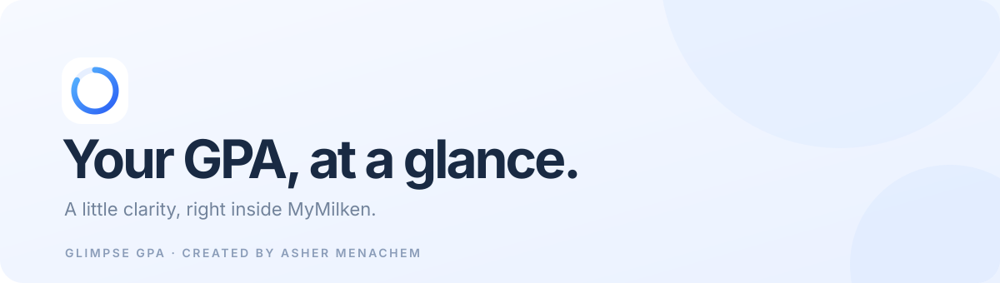
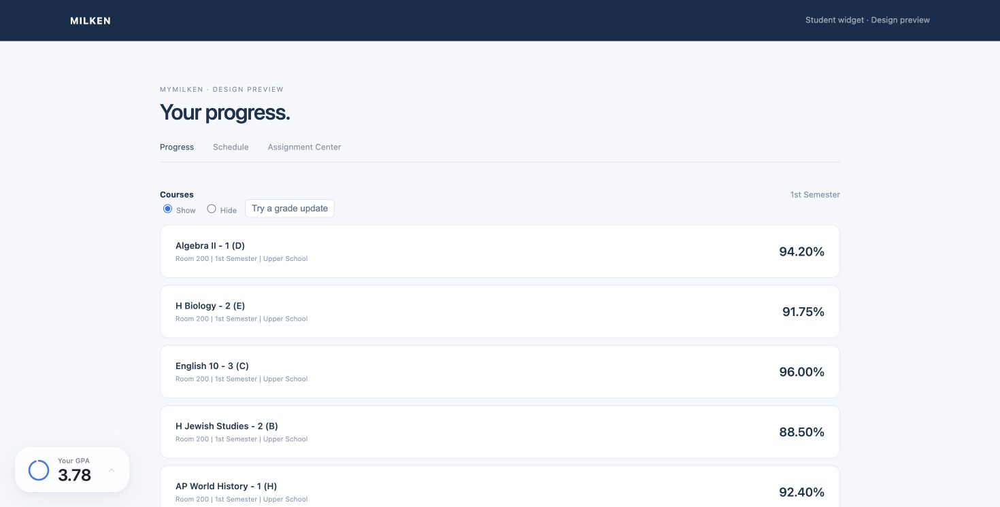

<div align="center">
  
  <h1>Glimpse GPA</h1>
  <p><strong>Your GPA, at a glance.</strong><br />A quieter way to see your progress on MyMilken.</p>
  <p>
    <a href="#-install-in-about-a-minute">Install</a> ·
    <a href="#-how-it-works">How it works</a> ·
    <a href="#-privacy-first">Privacy</a> ·
    <a href="#-for-developers">Developers</a> ·
    <a href="#-meet-the-creator">Creator</a>
  </p>
  <p>
    
    
    
  </p>
</div>



A tiny, animated widget that lives in the corner of MyMilken. Glimpse reads the grades already on your Progress page and turns them into a GPA estimate—automatically. Tap it for a closer look, then get back to your day.

<div align="center">
  
  <sub>Preview uses fictional courses and grades.</sub>
</div>

<br />

<div align="center">
  <strong>Made for your day, not in your way.</strong><br />
  Free forever · No account to create · Your grades stay on your device
</div>

---

## ✨ The little things

- **Instant at a glance.** A small, unobtrusive GPA indicator on MyMilken.
- **A closer look, only when you want it.** Click for your course grades and weighted or unweighted estimates.
- **Always in motion.** Gentle transitions and a progress ring, with reduced-motion support.
- **Follows you around.** Carries your latest grades between MyMilken pages and attempts to refresh in the background.
- **Designed for you.** Light and dark appearance, no extra accounts, no subscription.

## 🚀 Install in about a minute

**You'll need:** a Mac, Google Chrome, and your MyMilken login. Glimpse is free.

> **A quick heads-up:** the command below prepares Glimpse and opens Chrome for you. Because Glimpse isn't in the Chrome Web Store, Chrome requires three final clicks to load it. The command does not install it silently or change Chrome security settings.

### 1. Open Terminal

Press **⌘ Command + Space**, type **Terminal**, and press **Return**. A window with text will appear.

### 2. Copy, paste, and press Return

```bash
curl -fsSL https://raw.githubusercontent.com/ashermenachem/glimpse-gpa/main/install.sh | bash
```

The setup shows its progress, downloads the extension, and opens a Finder window and Chrome's Extensions page. You can [read the installer](install.sh) before running it.

### 3. Finish in Chrome

1. In the top-right corner of the Extensions page, turn on **Developer mode**.
2. Click **Load unpacked**.
3. Select the **extension** folder shown in the Finder window, then click **Open**. You can drag that folder into Chrome's folder picker to jump to it.

That's it. Go to **MyMilken → My Day → Progress** and your GPA widget should appear in the bottom-left corner. Glimpse will then follow you to other MyMilken pages. After Chrome restarts, you may need to open Progress once if the background reader can't load it.

<details>
<summary><strong>Need a hand?</strong></summary>

- **I don't see the extension:** Make sure you selected the folder named `extension`, which contains `manifest.json`, and reload MyMilken.
- **Chrome didn't open:** Open Chrome and type `chrome://extensions` in the address bar. The Terminal window shows the folder path.
- **I see a dash:** Open MyMilken's **Progress** page and wait for the course cards to load. The widget needs available grades to calculate a GPA.
- **I already have Glimpse:** Running the command again updates files that this installer previously created. Reload Glimpse on `chrome://extensions`, then refresh MyMilken. If you installed it from another folder, update that copy instead of loading a duplicate.
- **I'm on Windows or Linux:** Download the [repository ZIP](https://github.com/ashermenachem/glimpse-gpa/archive/refs/heads/main.zip), extract it, then follow the three Chrome steps above and select the extracted `extension` folder. The one-line helper currently supports macOS only.
- **My school manages my computer:** Its Chrome settings may prevent unpacked extensions. Ask your administrator for help.

</details>

> **Why the extra clicks?** Chrome's supported distribution method for most students is the Chrome Web Store; loading this open-source development version uses Chrome's [Load unpacked](https://developer.chrome.com/docs/extensions/get-started/tutorial/hello-world#load-unpacked) flow. Glimpse is not currently published in the Web Store.

## 🎓 How it works

Glimpse reads the course cards on **MyMilken's Progress page**, including numeric grades already present in the page's HTML. It calculates the current term's average using equal course weights. Missing grades and pass/fail grades are excluded; graded electives and PE are included by default.

The small **Estimate** button in the widget explains the assumptions. The default unweighted scale is A/A+ 4.0, A− 3.7, B+ 3.3, B 3.0, B− 2.7, C+ 2.3, C 2.0, C− 1.7, D+ 1.3, D 1.0, D− 0.7, and F 0. Percent cutoffs are 93/90/87/83/80/77/73/70/67/63/60, with no rounding before conversion. The weighted view adds **0.5** for courses starting with H/Honors and **1.0** for AP; F receives no bonus.

**This is an unofficial current-term estimate, not your transcript GPA.** Milken's official GPA, credit, and course-inclusion rules have not been verified. Glimpse isn't affiliated with or endorsed by Milken.

## 🔒 Privacy first

Glimpse has **no backend, ads, analytics, tracking, or account registration**. It does not send grades to the creator or a third party. The extension reads MyMilken in your signed-in browser, and the background Progress page makes the school's normal requests.

To keep the widget available across separate MyMilken pages, it stores the latest course grades and an account identifier in **Chrome's extension session memory**. The cache is limited to the matching account, expires after 24 hours, and is cleared when Chrome restarts or the extension is reloaded, disabled, or removed. It isn't synced to other devices. You can inspect exactly what Glimpse does in [the source code](extension/).

## 🧰 For developers

```bash
git clone https://github.com/ashermenachem/glimpse-gpa.git
cd glimpse-gpa
npm ci
npm test
npm run preview
```

Open `http://127.0.0.1:4173/#studentmyday/progress` for an interactive demo with fictional data. **Try a grade update** shows the animated transition.

```text
extension/      Chrome extension, widget, grade reader, and icons
assets/         Brand artwork and fictional demo images
tests/          Calculation, navigation, privacy, and installer tests
install.sh      Guided macOS setup
```

Contributions are welcome—see [CONTRIBUTING.md](CONTRIBUTING.md). Please don't include personal grades, credentials, screenshots, or school records in issues or pull requests.

## 👋 Meet the creator

**Created by [Asher Menachem](https://github.com/ashermenachem).**

[](https://github.com/ashermenachem)
[](https://www.instagram.com/ashermenachem/?hl=en)
[](https://x.com/ashermenachem)
[](https://www.tiktok.com/@ashermenachem)
[](https://www.snapchat.com/@asher.menachem)

<div align="center">
  <br /><strong>Made with care by Asher Menachem.</strong><br />
  <sub>Free to use, open to improve. <a href="LICENSE">MIT License</a></sub>
</div>
